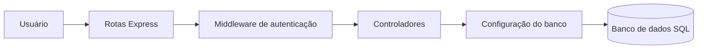
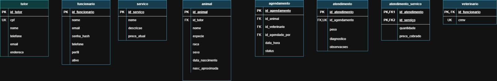

# Documentação Técnica — PetVida
 
## 1. Visão geral
 
O **PetVida** é um sistema de gestão veterinária desenvolvido como projeto do curso técnico do SENAC. O objetivo é apoiar o cadastro de tutores e animais, o agendamento de consultas, os atendimentos veterinários e a geração de relatórios gerenciais.
 
Este documento descreve a arquitetura planejada e os componentes técnicos do projeto. Os requisitos funcionais e as regras de negócio estão detalhados em `Documentação/Requisitos.md`.
 
## 2. Objetivos técnicos
 
- Separar responsabilidades entre rotas, controladores, middleware e configuração da base de dados.
- Manter perfis de acesso distintos: Recepcionista, Veterinário e Gerente.
- Preservar o histórico de funcionários desativados e dos valores cobrados em atendimentos anteriores.
- Validar dados únicos, conflitos de agenda e duração fixa das consultas.
- Disponibilizar consultas e relatórios gerenciais.
- Organizar em estrutura de tabelas as informações do banco de dados;
 
## 3. Tecnologias previstas
 
- **Backend:** Node.js.
- **Servidor** Express, com base em arquivos organizados em `backend/src`.
- **Banco de dados:** SQL relacional.
- **Ambiente:** Windows e terminal PowerShell.
 
> Os scripts de banco e os arquivos do backend são atualmente os pontos principais da implementação. Dependências e bibliotecas específicas deverão ser registrados no `package.json` assim que forem adicionados ao projeto.
 
## 4. Estrutura do projeto
 
```text
PetVida/
├── README.md
├── Documentação/
│   └── Requisitos.md
└── PetVida/
    ├── backend/
    │   └── src/
    │       ├── app.js
    │       ├── server.js
    │       ├── config/
    │       │   └── configDB.js
    │       ├── controllers/
    │       │   └── authControllers.js
    │       ├── middlewares/
    │       │   └── authMiddleware.js
    │       └── routes/
    │           └── authRoutes.js
    ├── database/
    │   ├── 01-create.sql
    │   ├── 02-inserts.sql
    │   └── 03-consultas.sql
    └── docs/
        ├── apresentacaocliente.md
        ├── documentacaotecnica.md
        └── requisitos.md
```
 
## 5. Arquitetura
 

 
### Responsabilidades
 
- `server.js`: inicialização do servidor e definição da porta.
- `app.js`: configuração da aplicação Express e registro dos middlewares e rotas.
- `config/configDB.js`: dados e criação da conexão com o banco.
- `routes/`: exposição dos endpoints HTTP.
- `controllers/`: implementação das regras e operações solicitadas pelas rotas.
- `middlewares/`: autenticação e autorização por perfil.
- `database/`: criação do esquema, dados de exemplo e consultas SQL.
 
## 6. Modelo conceitual de dados
 

 
### Observações sobre o modelo
 
- Um tutor pode possuir vários animais, mas cada animal pertence a um único tutor responsável.
- Cada agendamento possui duração fixa de 30 minutos.
- O mesmo veterinário não pode ter dois agendamentos na mesma data e horário.
- Um atendimento pode incluir vários serviços por meio da tabela associativa.
- `preco_cobrado` é obrigatório na tabela associativa para preservar o preço existente no atendimento, mesmo após alteração do preço atual do serviço.
- Funcionários não devem ser excluídos; o campo `ativo` deve controlar a desativação.
- CPF do tutor e e-mail do funcionário devem possuir restrição de unicidade.
 
## 7. Perfis e permissões
 
| Operação | Recepcionista | Veterinário | Gerente |
|---|---:|---:|---:|
| Cadastrar/editar tutores | ✓ | — | ✓ |
| Cadastrar/editar animais | ✓ | — | ✓ |
| Agendar, remarcar e cancelar consultas | ✓ | — | ✓ |
| Visualizar agenda de todos os veterinários | ✓ | — | ✓ |
| Visualizar sua própria agenda | — | ✓ | ✓ |
| Registrar atendimento e diagnóstico | — | ✓ | ✓ |
| Consultar histórico do animal | — | ✓ | ✓ |
| Cadastrar funcionários | — | — | ✓ |
| Cadastrar e alterar serviços/preços | — | — | ✓ |
| Consultar faturamento e relatórios gerenciais | — | — | ✓ |
 
## 8. Autenticação e autorização
 
- Cada funcionário possui login e senha individuais.
- Senhas não devem ser armazenadas em texto puro; deve ser utilizado hash seguro.
- A autenticação deve ocorrer antes do acesso às rotas protegidas.
- O middleware deve validar o token ou sessão e adicionar os dados do usuário à requisição.
- A autorização deve verificar o perfil em cada operação sensível.
- Um funcionário desativado não poderá autenticar ou continuar com sessões válidas.
 
## 9. Modelo de API
 
Os endpoints abaixo representam o modelo esperado da API. Os nomes podem ser ajustados durante a implementação.
 
| Método | Rota | Perfil | Descrição |
|---|---|---|---|
| POST | `/auth/login` | Todos | Autenticação do funcionário |
| POST | `/tutores` | Recepcionista/Gerente | Cadastrar tutor |
| PUT | `/tutores/:id` | Recepcionista/Gerente | Editar tutor |
| POST | `/animais` | Recepcionista/Gerente | Cadastrar animal |
| PUT | `/animais/:id` | Recepcionista/Gerente | Editar animal |
| POST | `/agendamentos` | Recepcionista/Gerente | Criar consulta |
| PATCH | `/agendamentos/:id` | Recepcionista/Gerente | Remarcar ou cancelar consulta |
| GET | `/agendamentos/minha-agenda` | Veterinário/Gerente | Consultar agenda do veterinário |
| POST | `/atendimentos` | Veterinário/Gerente | Registrar atendimento |
| GET | `/animais/:id/historico` | Veterinário/Gerente | Consultar histórico do animal |
| POST | `/servicos` | Gerente | Cadastrar serviço |
| PATCH | `/servicos/:id/preco` | Gerente | Alterar preço atual do serviço |
| GET | `/relatorios/gerencial` | Gerente | Consultar relatório gerencial |
 
### Resposta padrão de erro
 
```json
{
  "sucesso": false,
  "erro": "Descrição objetiva do problema",
  "codigo": "CODIGO_DA_VALIDACAO"
}
```
 
## 10. Validações e regras de negócio
 
- CPF do tutor: obrigatório, válido e único.
- E-mail do funcionário: obrigatório, válido e único.
- Senha: mínima conforme política definida pela equipe.
- Animal: deve estar vinculado a tutor existente.
- Consulta: a combinação de veterinário, data e horário deve ser única.
- Consulta: duração automática de 30 minutos.
- Atendimento: somente veterinário autorizado ou gerente pode registrá-lo.
- Histórico: deve listar datas, veterinário, diagnóstico e serviços realizados.
- Relatório: deve contemplar:
  - agenda do veterinário;
  - animais atendidos e respectivos tutores;
  - faturamento total do mês;
  - faturamento por veterinário;
  - três serviços mais realizados no mês;
  - tutores com consultas no dia seguinte e respectivos telefones.
 
## 11. Scripts do banco de dados
 
A pasta `database` deve ser executada na seguinte ordem:
 
1. `01-create.sql`: criação das tabelas, chaves primárias, estrangeiras e restrições.
2. `02-inserts.sql`: carga inicial de perfis, usuários e dados de teste.
3. `03-consultas.sql`: consultas operacionais e relatórios.
 
Exemplo conceitual de execução:
 
```sql
source 01-create.sql;
source 02-inserts.sql;
source 03-consultas.sql;
```
 
Cada script deve ser idempotente sempre que possível e não deve depender de dados de ambientes anteriores sem validação.
 
## 12. Configuração do backend
 
O backend deve ser iniciado a partir de `PetVida/backend`. Recomenda-se configurar as variáveis sensíveis por ambiente:
 
```env
PORT=3306
DB_HOST=localhost
DB_PORT=3306
DB_NAME=petvida
DB_USER=usuario
DB_PASSWORD=senha
JWT_SECRET=troque-em-producao
```
 
### Boas práticas
 
- Não versionar senhas ou credenciais reais.
- Utilizar arquivo `.env` ignorado pelo Git.
- Validar parâmetros recebidos pela API.
- Usar transações em operações que envolvam mais de uma tabela.
- Registrar erros sem expor dados sensíveis.
- Aplicar CORS apenas para origens autorizadas.
 
## 13. Ambiente de desenvolvimento
 
1. Instalar Node.js e um banco de dados SQL compatível.
2. Criar a base de dados do PetVida.
3. Executar os scripts da pasta `database` em ordem numérica.
4. Configurar a conexão em `backend/src/config/configDB.js`.
5. Instalar as dependências do backend.
6. Executar o servidor a partir de `backend/src/server.js`.
7. Testar os endpoints por meio de um cliente HTTP.
 
## 14. Testes recomendados
 
- Login válido e inválido.
- Bloqueio de acesso por perfil não autorizado.
- Cadastro de CPF ou e-mail duplicado.
- Vinculação de animal a tutor inexistente.
- Agendamento no mesmo dia e horário pelo mesmo veterinário.
- Agendamento com duração diferente de 30 minutos.
- Histórico completo de um animal.
- Alteração de preço sem modificar atendimentos anteriores.
- Desativação de funcionário sem exclusão do histórico.
- Faturamento mensal total e por veterinário.
- Consulta dos três serviços mais realizados.
- Lista de consultas agendadas para o dia seguinte.
 
## 15. Segurança
 
- Hash seguro para senhas.
- Controle de acesso baseado em perfis.
- Uso de parâmetros preparados ou ORM para evitar SQL Injection.
- Validação da entrada em todos os endpoints.
- Proteção contra excesso de requisições no login.
- Registro de acessos e alterações administrativas relevantes.
- Tratamento adequado de erros sem divulgação da estrutura interna.
 
## 16. Escopo excluído
 
Os seguintes itens ficam fora da fase atual:
 
- Pagamento online.
- Controle de estoque de medicamentos.
- Envio de lembretes por WhatsApp.
 
## 17. Estado atual da implementação
 
Os arquivos de implementação backend e banco de dados foram encontrados vazios ou ainda não definidos nesta versão do projeto. Portanto, este documento representa o modelo técnico esperado e poderá ser atualizado conforme os scripts, endpoints e tabelas forem implementados.
 
Modelo de Documentação — Requisitos de Negócio
1. Objetivo
Este documento formaliza as regras de negócio do sistema PetVida, utilizado pela clínica veterinária no gerenciamento de tutores, animais, funcionários, agendas, atendimentos, serviços e relatórios gerenciais.
2. Escopo
2.1. Dentro do escopo
•Cadastro e manutenção de tutores e animais.
•Cadastro e desativação de funcionários.
•Autenticação e controle de acesso por perfil.
•Agendamento, remarcação e cancelamento de consultas.
•Registro de atendimentos, diagnósticos, peso e observações.
•Registro histórico dos serviços realizados.
•Consulta de agenda e histórico de animais.
•Geração de relatórios gerenciais.
2.2. Fora do escopo
•Pagamento online.
•Controle de estoque de medicamentos.
•Envio de lembretes por WhatsApp.
3. Definições
Termo	Definição
Tutor	Responsável pelos animais atendidos pela clínica. Não acessa o sistema diretamente.
Funcionário	Usuário autorizado a acessar o sistema por meio de login e senha.
Animal	Paciente vinculado obrigatoriamente a um tutor responsável.
Consulta	Agendamento de atendimento entre um animal e um veterinário em data e horário definidos.
Atendimento	Registro clínico realizado após ou durante a consulta.
Serviço	Procedimento realizado em um atendimento e associado ao seu respectivo valor cobrado.
Desativação	Alteração do status do funcionário para inativo, sem apagar seu registro ou histórico.
4. Perfis de usuário
4.1. Recepcionista
O recepcionista é responsável pelas informações administrativas e pela agenda da clínica.
Pode:
•Cadastrar e editar tutores.
•Cadastrar e editar animais.
•Agendar consultas.
•Remarcar consultas.
•Cancelar consultas.
•Visualizar a agenda de todos os veterinários.
Não pode:
•Visualizar diagnósticos.
•Alterar preços dos serviços.
•Visualizar informações de faturamento.
4.2. Veterinário
O veterinário é responsável pelo atendimento clínico e pelos registros veterinários.
Pode:
•Visualizar somente sua própria agenda.
•Registrar atendimentos.
•Registrar o peso do animal.
•Registrar diagnósticos.
•Registrar observações do atendimento.
•Registrar os serviços realizados.
•Consultar o histórico completo do animal atendido.
Não pode:
•Agendar consultas.
•Alterar preços dos serviços.
•Visualizar atendimentos de outros veterinários, exceto o histórico necessário do animal atendido.
4.3. Gerente
O gerente possui acesso administrativo e gerencial ampliado.
Pode:
•Realizar todas as operações permitidas ao recepcionista.
•Realizar todas as operações permitidas ao veterinário.
•Cadastrar funcionários.
•Cadastrar serviços.
•Alterar preços dos serviços.
•Visualizar relatórios de faturamento e dados gerenciais.
Não pode:
•Não foram especificadas restrições adicionais.
5. Requisitos de negócio
RN01 — Cadastro dos tutores
O sistema não oferecerá acesso aos tutores. Os dados dos tutores deverão ser cadastrados por um funcionário autorizado.
Perfis autorizados: Recepcionista e Gerente.
Critério de aceite:
•O tutor não possui usuário, login ou senha.
•Seus dados podem ser cadastrados ou editados por recepcionista ou gerente.
RN02 — Perfis de acesso
Todo usuário do sistema deverá estar associado a um dos seguintes perfis:
•Recepcionista.
•Veterinário.
•Gerente.
Critério de aceite:
•O usuário não pode utilizar o sistema sem perfil definido.
•As operações disponíveis são determinadas pelo perfil.
RN03 — Vinculação entre tutor e animal
Um tutor pode possuir vários animais. Entretanto, cada animal deve possuir um único tutor responsável.
Critério de aceite:
•Não é permitido cadastrar um animal sem tutor responsável.
•O sistema deve permitir a associação de vários animais ao mesmo tutor.
RN04 — Unicidade da agenda do veterinário
Um veterinário não pode possuir dois agendamentos no mesmo dia e horário.
Critério de aceite:
•O sistema deve rejeitar uma consulta cujo veterinário já esteja agendado no mesmo dia e horário.
•O conflito deve ser informado ao usuário.
RN05 — Duração fixa da consulta
Toda consulta deve possuir duração fixa de 30 minutos.
Critério de aceite:
•A duração não pode ser diferente de 30 minutos.
•O horário final deve ser calculado como horário inicial acrescido de 30 minutos.
RN06 — Relacionamento entre atendimento e serviços
Um atendimento pode incluir vários serviços. Cada serviço pode ser utilizado em vários atendimentos.
Critério de aceite:
•O atendimento deve permitir a seleção de um ou mais serviços.
•Um serviço pode ser associado a atendimentos diferentes.
RN07 — Preservação do preço cobrado
O preço cobrado por cada serviço deve ser registrado no momento do atendimento.
Caso o preço cadastrado do serviço seja alterado posteriormente, os atendimentos anteriores deverão manter o valor originalmente cobrado.
Critério de aceite:
•Cada relação entre atendimento e serviço deve armazenar o preço cobrado.
•A alteração do preço atual não altera valores registrados anteriormente.
•O relatório deve considerar o valor cobrado no atendimento.
RN08 — Desativação de funcionários
Funcionários que saírem da clínica devem ser desativados e não excluídos do sistema.
Critério de aceite:
•O funcionário desativado mantém seu cadastro e registros históricos.
•O funcionário desativado não poderá realizar login.
•A operação não remove registros associados ao funcionário.
RN09 — Unicidade de CPF e e-mail
•O CPF de cada tutor deve ser único no sistema.
•O e-mail de cada funcionário deve ser único no sistema.
Critério de aceite:
•O sistema deve impedir o cadastro de CPF já existente para outro tutor.
•O sistema deve impedir o cadastro de e-mail já existente para outro funcionário.
•Uma mensagem clara deve informar quando houver duplicidade.
RN10 — Agenda gerencial dos veterinários
O sistema deve gerar dados gerenciais relacionados à agenda dos veterinários e aos animais atendidos.
Critério de aceite:
•O relatório deve relacionar o veterinário aos agendamentos.
•O relatório deve relacionar cada animal ao respectivo tutor.
RN11 — Histórico clínico do animal
O relatório deve apresentar o histórico do animal, incluindo:
•Data do atendimento.
•Veterinário responsável.
•Diagnóstico.
•Serviços realizados.
Critério de aceite:
•O histórico deve estar associado ao animal consultado.
•As informações devem estar organizadas em ordem cronológica.
•Veterinários devem consultar somente o histórico relacionado aos animais que estão atendendo ou conforme permissão gerencial.
RN12 — Faturamento mensal
O relatório gerencial deve apresentar o faturamento do mês.
Critério de aceite:
•O sistema deve apresentar o faturamento total do mês.
•O sistema deve apresentar o faturamento por veterinário.
•A origem dos valores deve ser o preço cobrado no atendimento.
RN13 — Serviços mais realizados
O relatório gerencial deve apresentar os três serviços mais realizados no mês.
Critério de aceite:
•A informação deve considerar somente o mês selecionado.
•Os serviços devem ser classificados pela quantidade de realizações.
•Em caso de empate, o sistema deve aplicar um critério de ordenação definido pela equipe.
RN14 — Consultas do dia seguinte
O relatório deve apresentar os tutores cujos animais possuem consultas marcadas para o dia seguinte.
Critério de aceite:
•O relatório deve conter o nome do tutor e o telefone de contato.
•A lista deve considerar consultas válidas ou confirmáveis para o dia seguinte.
•Os dados devem estar disponíveis para o recepcionista realizar a confirmação.
6. Regras por processo
6.1. Cadastro de tutor e animal
1.O recepcionista ou gerente cadastra o tutor.
2.O sistema valida os dados obrigatórios e o CPF único.
3.O tutor é vinculado como responsável pelos animais cadastrados.
4.O animal não pode ser cadastrado sem tutor.
6.2. Agendamento
1.O recepcionista ou gerente seleciona o animal e o veterinário.
2.O usuário informa data e horário.
3.O sistema verifica conflito na agenda do veterinário.
4.O sistema registra duração fixa de 30 minutos.
5.O agendamento fica disponível na agenda correspondente.
6.3. Remarcação e cancelamento
1.O recepcionista ou gerente informa o novo horário ou solicita o cancelamento.
2.Na remarcação, o sistema valida novamente os conflitos de agenda.
3.O agendamento é atualizado ou cancelado.
4.O histórico deve permitir identificar a alteração realizada.
6.4. Atendimento
1.O veterinário ou gerente registra o atendimento do animal.
2.O sistema registra peso, diagnóstico, observações e serviços realizados.
3.O veterinário informa ou consulta o histórico necessário do animal.
4.O sistema preserva o preço cobrado de cada serviço no atendimento.
6.5. Desativação de funcionário
1.O gerente solicita a desativação do funcionário.
2.O sistema altera o funcionário para o status inativo.
3.Os registros históricos associados são preservados.
4.O usuário desativado perde o acesso ao sistema.
6.6. Geração de relatório
1.Somente o gerente pode visualizar o relatório gerencial completo.
2.O gerente seleciona o período ou o mês do relatório.
3.O sistema reúne agenda, atendimentos, tutores, faturamento e serviços.
4.O relatório apresenta os dados definidos neste documento.
7. Matriz de permissões
Funcionalidade	Recepcionista	Veterinário	Gerente
Cadastrar tutor	Permitido	Não permitido	Permitido
Editar tutor	Permitido	Não permitido	Permitido
Cadastrar animal	Permitido	Não permitido	Permitido
Editar animal	Permitido	Não permitido	Permitido
Agendar consulta	Permitido	Não permitido	Permitido
Remarcar consulta	Permitido	Não permitido	Permitido
Cancelar consulta	Permitido	Não permitido	Permitido
Visualizar agenda geral	Permitido	Não permitido	Permitido
Visualizar própria agenda	Não permitido	Permitido	Permitido
Registrar atendimento	Não permitido	Permitido	Permitido
Registrar peso	Não permitido	Permitido	Permitido
Registrar diagnóstico	Não permitido	Permitido	Permitido
Registrar observações	Não permitido	Permitido	Permitido
Consultar histórico do animal	Não permitido	Permitido, conforme regra	Permitido
Cadastrar funcionário	Não permitido	Não permitido	Permitido
Cadastrar serviço	Não permitido	Não permitido	Permitido
Alterar preço de serviço	Não permitido	Não permitido	Permitido
Visualizar faturamento	Não permitido	Não permitido	Permitido
Visualizar relatório gerencial	Não permitido	Não permitido	Permitido
8. Requisitos não funcionais relacionados
•Cada funcionário deverá possuir credenciais individuais.
•As informações devem ser protegidas conforme o perfil do usuário.
•Os dados devem manter integridade mesmo após alterações cadastrais.
•O histórico de atendimentos não pode ser removido por alteração de funcionário ou serviço.
•Diagnósticos e informações clínicas devem ser restritos ao acesso autorizado.
•Dados de faturamento devem ser restritos ao perfil gerente.
9. Histórico de alterações
 
Versão	Data	Descrição
1.0	18/11/2026	Modelo formal dos requisitos de negócio baseado no documento inicial.
 
 